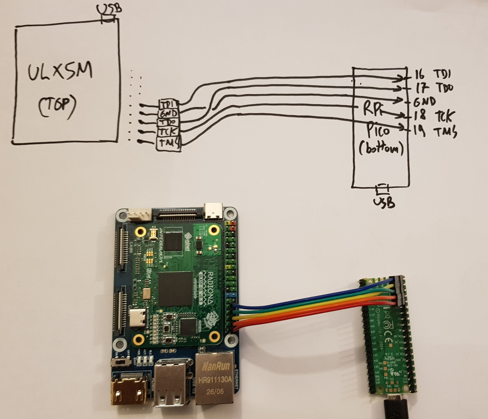

ULX5M Tutorial
==============

This tutorial is WIP
- [x] dirtyJtag on Rpi pico
- [ ] connect pico to JTAG pins on carrier board
- [ ] install GateMate toolchain
- [ ] first blinky
- [ ] FemtoRV
- [ ] add a tty (through a FTDI rs232-USB adapter)

Material
--------
- a ULX5M of course
- a carrier board for ULX5M (any carrier board for Raspberry CM5 will do)
- a raspberry pico (to be configured as a JTAG programmer using DirtyJTAG)


DirtyJTag
---------

```
sudo apt install cmake python3 build-essential gcc-arm-none-eabi libnewlib-arm-none-eabi libstdc++-arm-none-eabi-newlib
git clone --recurse-submodules https://github.com/raspberrypi/pico-sdk
git clone https://github.com/phdussud/pico-dirtyJtag.git
cd pico-dirtyJtag
export PICO_SDK_PATH=xxx/yyy/pico-sdk
```
edit CMakeLists.txt:
 - uncomment line with PICO_SDK_PATH
 - if you have a rpi 2350, change line set(PICO_BOARD pico2)

```
mkdir build
cd build
cmake ../ -DPICO_BOARD=pico2
cmake ../ -DPICO_BOARD=pico2
```
If everything goes well, this will generate:
- dirtyJtag.uf2
- _deps/picotool/picotool

Now program the pico (can be done also with picotool but it seems that my picotool is not compiled with USB support):
- plug the pico, a new drive will appear. If not the case, unplug it, press bootsel, plug it while keeping bootsel pressed, release bootsel
- drag-drop dirtyJtag.uf2 to the drive

The pico should reboot. To see whether it works:

```
lsusb | grep c0ca
```

Now test whether openFPGALoader can detect it:
```
openFPGALoader -c dirtyJtag --detect
```

Connect pico to carrier board
-----------------------------

You will need 5 female-female Dupont wires, to connect TDI, TDO, TCK, TMS and GND.

- [ULX5M pins](https://github.com/intergalaktik/ulx4m-documentation/tree/main/ulx4m-ld#pinout) (same as ULX4M)
- dirtyJtag pins: check dirtyJtagConfig.h

My setup:



(mind the order of the pins! TDI,GND,TDO,TCK,TMS on one side, TDI,TDO,GND,TCK,TMS on the other side, GND and TDO are swapped !!)


Notes, links
------------

USB <-> DirtyJTAG:
- https://deepbluembedded.com/openfpgaloader-dirtyjtag-pi-pico-jtag-tutorial-windows/


https://github.com/phdussud/pico-dirtyJtag


1. Install [CologneChip's version of Yosys and NextPNR](https://github.com/YosysHQ/oss-cad-suite-build/releases/).
